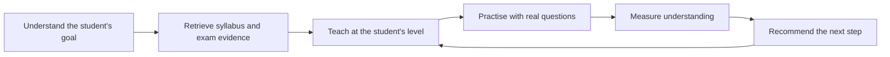
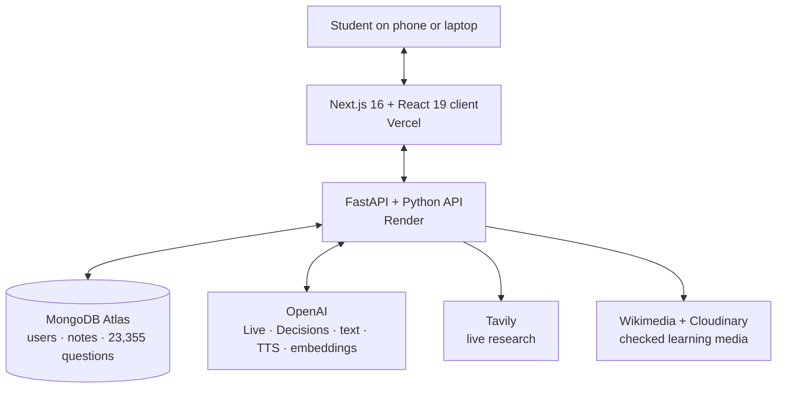

# StudyMaster

### The AI teacher built around how Nigerian students actually prepare for WAEC and JAMB

[](https://studymaster-rho.vercel.app)
[](https://nextjs.org/)
[](https://openai.com/)
[](https://github.com/ajalaabdullah-webdev/studymaster-server)

**[Try StudyMaster live](https://studymaster-rho.vercel.app)** · **[Explore the AI backend](https://github.com/ajalaabdullah-webdev/studymaster-server)**

---

## This is a measurable learning crisis

WAEC and JAMB are not ordinary school tests. They sit between millions of young Nigerians and the
next stage of their education. Behind every result is a student trying to qualify for a course, enter
a university or keep a career plan alive.

The scale of the problem is visible in national data:

| Evidence | What it means for a learner |
|---|---|
| **74% of Nigerian children aged 7–14 lack basic reading and mathematics skills.** ([UNICEF, 2024](https://www.unicef.org/nigeria/press-releases/immediate-action-needed-protect-nigerias-children-and-schools)) | Many candidates enter senior secondary preparation with unresolved foundational gaps. More revision material alone will not repair a concept they were never helped to understand. |
| Nigeria needs **nearly 200,000 trained teachers**, while only 27% of children aged 7–14 demonstrate reading comprehension and 25% can solve simple mathematics problems. ([UNICEF State of Nigeria's Children, 2024](https://www.unicef.org/nigeria/media/10591/file/State-of-Nigerias-Children_Summary-of-the-2024-Updated-SitAn.pdf)) | Individual feedback is scarce. A teacher managing a large class cannot always discover where every student became confused. |
| In the final 2025 UTME statistics, only **29.08%** of 1,925,463 candidates scored 200 or above; **6.03%** reached 250 and **0.87%** reached 300. ([JAMB official bulletin, 26 May 2025](https://www.jamb.gov.ng/Bulletin/2025/JAMBulletin_26-05-2025.pdf)) | JAMB is a competitive ranking examination—not a universal pass/fail test. These figures still show how narrow the path becomes for students targeting competitive institutions and courses. |
| In the corrected 2025 WASSCE results, **62.96%** obtained at least five credits including English and Mathematics, down from **72.12%** in 2024. ([Federal Ministry of Information, citing official WAEC statistics](https://fmino.gov.ng/fg-reaffirms-zero-tolerance-for-exam-malpractice-as-waec-performance-and-credibility-improve/)) | Of the 1,969,313 candidates who sat, roughly **729,000 did not reach this key five-credit benchmark**. For many, that blocks or delays the route into tertiary education. |
| Fewer than **16% of children from low-income households complete senior secondary school**, compared with 90% from wealthy households. ([UNICEF State of Nigeria's Children, 2024](https://www.unicef.org/nigeria/media/10591/file/State-of-Nigerias-Children_Summary-of-the-2024-Updated-SitAn.pdf)) | The students who most need personal teaching are often the least able to purchase it. |

These numbers do **not** prove that one app can solve every structural problem in Nigerian education.
They prove that access to a school is not the same as access to understanding—and that exam
preparation cannot be reduced to downloading another PDF.

### The gap StudyMaster is built to close

For many candidates, preparation is still a disconnected collection of generic AI answers, old
textbooks, crowded lessons, long videos and past questions that reveal the correct option but never
repair the misunderstanding.

The missing layer is a continuous feedback system:

| Demonstrated problem | StudyMaster intervention | Outcome we can measure |
|---|---|---|
| Foundational gaps follow the student into exam preparation | Diagnostic baseline plus explanations that adapt to the learner's stated level | Change between baseline, quiz, practice and mock-exam performance |
| Too little individual teacher time | A live voice teacher that listens, allows interruption, writes on a synchronized board and checks understanding | Lesson completion, in-class question results and concepts mastered |
| Generic content is detached from WAEC/JAMB | RAG over live research and **23,355 real past questions** | Notes and practice tied to actual subjects, topics and examiner patterns |
| Past papers are searched by wording rather than meaning | Hybrid label, keyword and vector retrieval | Relevant questions recovered even when the learner uses different words |
| Reading creates an illusion of mastery | Every note leads into retrieval practice, explanations and a next step | Quiz accuracy, repeated-error reduction and study progression |
| Students cannot see whether effort is becoming readiness | One activity stream across notes, questions, quizzes, exams and live lessons | Readiness trend, subject performance, consistency and target progress |

StudyMaster is therefore not positioned as “AI that generates notes.” It is positioned as the
**learning infrastructure between a student's ambition and the examination result required to reach
it**.

## Our answer: a teacher that stays with the student

StudyMaster is an agentic study platform for Nigerian secondary-school students. It connects
curriculum-grounded notes, a conversational live teacher, more than **23,000 past questions**,
quizzes, diagnostics, a personal roadmap and readiness tracking into one continuous learning loop.



StudyMaster does not stop at “here is an answer.” It asks: **What does this learner already know?
What is the missing idea? How should it be taught? Can the learner now use it? What should happen
next?**

---

## The core experiences

### 1. Live Learning — a private lesson, not a voice attached to a chatbot

A student chooses a subject, enters a topic, explains what they are struggling with and selects a
lesson duration. StudyMaster prepares a lesson notebook, then opens a low-latency, two-way voice
classroom.

The live teacher:

- greets the learner by name and establishes what they already understand;
- teaches one concept at a time instead of delivering a long monologue;
- allows the learner to speak, interrupt, ask for another example or type a question;
- writes definitions, formulas, chemical equations, worked steps and questions on the board while
  speaking;
- keeps spoken explanations and board content synchronized;
- checks understanding with in-lesson questions and records quiz results;
- remembers the current board page and can resume a paused lesson;
- lets the student extend the class when the selected time ends;
- turns important board moments into persistent lesson notes.

The animated owl is not the teacher's intelligence; it is a calm social cue. Its listening,
thinking, speaking and writing states make the classroom feel alive without distracting from the
lesson.

**Why it matters:** recorded content assumes every learner is confused at the same point. Live
Learning changes direction when *this* student is confused.

### 2. Curriculum-grounded, versioned notes

The note agent does not ask a language model to write from memory and accept the first response. It
first retrieves live research, relevant WAEC/JAMB past questions and checked educational media. The
model then creates a structured note grounded in that evidence.

Students can ask for a deeper explanation, calculations, another angle or the next stage without
destroying their earlier work. Each generation becomes a new version linked to the chat response, so
the learner can move between versions and see how their understanding developed.

Every note can include:

- clear headings and progressive explanations;
- properly rendered mathematics and scientific notation;
- relevant, validated diagrams;
- worked examples and exam-style applications;
- a quiz that turns reading into retrieval practice;
- a suggested next learning step;
- OpenAI-powered read-aloud with synchronized highlighting.

**Why it matters:** students receive a learning sequence rather than a decorative summary.

### 3. Past Question Cruncher — practise by meaning, not only by keyword

StudyMaster's question bank contains **23,355 scraped past questions**, focused in the product on
WAEC and JAMB. Each question is enriched with an AI-generated topic label and a compact semantic
embedding.

When a student asks for a topic such as “basic grammar” or “number bases,” the system combines:

1. exact topic and question-text matches;
2. MongoDB Atlas vector search over 256-dimensional embeddings; and
3. cached AI keyword expansion for related examination vocabulary.

This means a relevant question can still be found when its wording does not repeat the student's
search phrase. Students can filter by examination, subject, year and topic, request AI explanations,
ask follow-up questions and practise the precise concept they are trying to master.

**Why it matters:** the past-question archive becomes a searchable map of what examiners test, not a
pile of old papers.

### 4. Mock exams and explanation after the score

Students can generate timed exam sessions from the question bank, submit answers and review results.
AI explanations and follow-up chat help turn a wrong answer into a diagnosed misconception instead
of a red mark that teaches nothing.

### 5. Personal onboarding, diagnostic and roadmap

StudyMaster begins with the student's examination, career ambition, target score, subjects and
starting level. It researches current Nigerian course requirements, recommends relevant subject
combinations, runs a diagnostic and builds a phased study roadmap.

The roadmap makes the product feel less like a toolbox and more like a teacher saying: **“Here is
where you are, here is where you want to go, and this is today's next step.”**

### 6. Readiness and progress intelligence

Notes studied, quizzes completed, past questions attempted, mock exams and live lessons feed an
activity stream. StudyMaster converts those signals into a smooth readiness estimate for each exam
and shows trends, subject performance, streaks and today's plan.

The goal is not to create a vanity percentage. It is to make progress visible and direct the learner
toward the weakest, highest-value area.

### 7. A complete learning environment

StudyMaster also includes an AI study coach, timetable, activity history, community, leaderboard,
study games, responsive mobile navigation, Google and email authentication, subscription controls,
admin tools and push-notification foundations.

---

## What makes the approach different

| Common study experience | StudyMaster's approach |
|---|---|
| Generic answer from model memory | Retrieval-augmented notes grounded in live sources and real exam questions |
| One long note that gets overwritten | Versioned notes that preserve every useful learning stage |
| Recorded lesson with no interruption | Real-time voice teacher with student interruption and a synchronized board |
| Keyword-only question search | Hybrid topic, semantic-vector and keyword-expansion retrieval |
| Practice score with no diagnosis | Explanations, follow-up questions and readiness signals |
| Same plan for every student | Career-aware onboarding, diagnostic baseline and personal roadmap |
| Separate tools with no continuity | One loop connecting teaching, practice, measurement and next steps |

---

## How the system fits together



The browser never receives private AI or database credentials. Authentication, retrieval,
generation, session orchestration and persistence stay behind the FastAPI boundary.

## Technology

### Client

- **Next.js 16**, **React 19** and **TypeScript/JavaScript**
- **Tailwind CSS 4** and Radix UI primitives
- **WebRTC** and browser media APIs for low-latency live audio
- **KaTeX**, `remark-math` and `rehype-katex` for mathematical notation
- **Framer Motion** for purposeful interaction and teacher states
- **Recharts** for progress and performance visualization
- **Firebase Cloud Messaging** foundations for notifications
- **Vercel Analytics** and Vercel deployment

### Intelligence and server

- **Python 3.11+**, **FastAPI**, **Pydantic** and **Beanie**
- **OpenAI GPT-Live** for the conversational classroom
- **OpenAI Decisions API** for fast bounded classroom decisions
- **OpenAI text-to-speech** for note narration
- **OpenAI embeddings** + **MongoDB Atlas Vector Search** for semantic retrieval
- **LiteLLM** for provider-independent text-model routing
- **LangGraph** for multi-step note, onboarding and roadmap agents
- **Tavily** for live web research and **Wikimedia** for educational diagrams
- **MongoDB Atlas** for accounts, lessons, notes, questions, attempts and progress
- **Render** for the Python service

## Built with OpenAI Codex

StudyMaster was built across multiple Codex sessions, not in one conversation. In those sessions,
Codex worked as an engineering collaborator across the product lifecycle: primary agents planned and
integrated the work while multiple specialist subagents handled bounded research, data, frontend,
backend, testing and review workstreams in parallel.

Some concrete contributions include:

- building the versioned note experience without breaking quizzes, progress or earlier notes;
- integrating OpenAI text-to-speech while preserving read-along highlighting;
- engineering the GPT-Live classroom, lesson preparation flow, synchronized board, timer,
  pause/resume state, extension flow and classroom persistence;
- building and running the scraping workflow that collected **23,355 past questions**, then cleaning,
  normalizing and structuring the data for use in StudyMaster;
- transforming the scraped corpus into an intelligence layer through curriculum-aware topic labels,
  embeddings, MongoDB Atlas vector indexing and hybrid retrieval;
- researching and integrating the OpenAI Decisions API for bounded, low-latency classroom actions;
- generating and integrating the animated owl state artwork;
- tracing OAuth, API, persistence and model-output failures across both repositories;
- validating production builds, server contracts and real provider endpoints;
- documenting the product, evidence base and architecture for reviewers.

The development workflow is guided by repository instructions plus custom Codex skills for phased
delivery, design quality, motion, software engineering, review and verification. These skills encoded
the owner's standards so they could be reused across sessions. Multi-agent orchestration was part of
the build: primary agents delegated independent work to specialist subagents, collected their
findings and changes, resolved integration issues and applied the final quality gate. The same skill
system remains available for future StudyMaster development.

For the detailed contribution record, verification approach and human/AI responsibility boundary,
read **[CODEX_WORKFLOW.md](./CODEX_WORKFLOW.md)**.

---

## Run the client locally

### Prerequisites

- Node.js 20+
- npm
- A running [StudyMaster server](https://github.com/ajalaabdullah-webdev/studymaster-server)

```bash
git clone https://github.com/ajalaabdullah-webdev/studymaster-client.git
cd studymaster-client
npm install
```

Create `.env.local`:

```env
NEXT_PUBLIC_API_URL=http://localhost:8000/api/v1
NEXT_PUBLIC_SITE_URL=http://localhost:3000
NEXT_PUBLIC_GOOGLE_CLIENT_ID=your-google-client-id
```

Then start the app:

```bash
npm run dev
```

Open [http://localhost:3000](http://localhost:3000).

For a production check:

```bash
npm run build
npm start
```

## Repository map

```text
app/                       Next.js routes
components/                Shared product UI
components/live-learning/  Voice classroom, teacher and board
components/notes/          Versioned note workspace and note chat
components/roadmap/        Personal study roadmap
components/readiness/      Exam-readiness interface
context/                   Authentication state
lib/                       Client utilities and integrations
public/                    Static assets and teacher artwork
```

---

## The impact we are working toward

StudyMaster cannot solve examination failure with a prettier dashboard. The product must help a
student spend each study hour better: understand instead of copy, practise what is actually tested,
receive feedback while the misconception is still fresh and know what to do next.

That is the ambition behind StudyMaster: **to make the continuity of a patient, curriculum-aware
teacher available to every student with a browser.**

## Links

- **Live product:** [studymaster-rho.vercel.app](https://studymaster-rho.vercel.app)
- **AI backend:** [github.com/ajalaabdullah-webdev/studymaster-server](https://github.com/ajalaabdullah-webdev/studymaster-server)

